# ascii-art-studio

[English](README.md) · **한국어**

**말로 설명하면, 움직이는 ASCII 아트를 Python 코드로 만들어 주는 Claude Code 스킬과 엔진**

`/ascii 눈 내리는 밤의 크리스마스 트리` 처럼 요청하면 Claude Code 가 그 작품 전용 Python 코드(`piece.py`)를 새로 씁니다.
글자·숫자·기호만으로 그리고, 화면에 보이는 모든 것은 코드가 계산합니다. 이미지 생성 AI·영상 생성 AI·API 키·서버는 쓰지 않습니다.

<p align="center">
  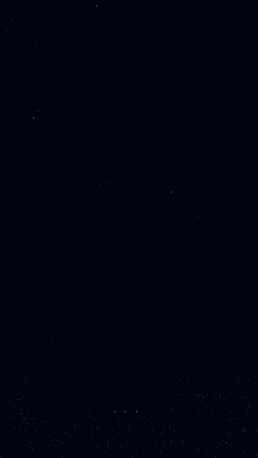
  &nbsp;&nbsp;
  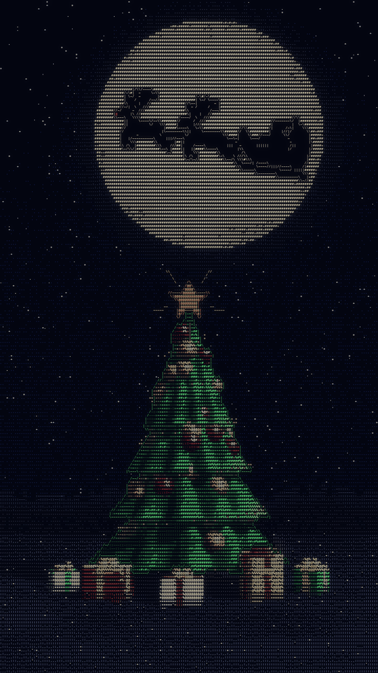
</p>

<p align="center"><sub>예제 작품 <code>pieces/christmas-tree</code> — 1080×1920, 180×192 글자 칸. 왼쪽은 등장 + 모션 일부(GIF), 오른쪽은 완성 화면.</sub></p>

> **이 저장소의 결과물은 영상이 아니라 코드입니다.** README 의 그림과 GIF 는 `python piece.py` 를 실제로 실행해서 뽑은 화면입니다. 같은 코드를 실행하면 같은 그림이 나오고, 테스트가 이를 픽셀 단위로 확인합니다.

---

## 목차

- [특징](#특징)
- [빠른 시작: 작품 실행하기](#빠른-시작-작품-실행하기)
- [새 작품 만들기: /ascii 스킬](#새-작품-만들기-ascii-스킬)
- [작업 흐름 (v4): 단계별 승인](#작업-흐름-v4-단계별-승인)
- [핵심 원칙: 결과물은 코드](#핵심-원칙-결과물은-코드)
- [작품 파일의 구조](#작품-파일의-구조)
- [저장소 구조](#저장소-구조)
- [엔진 (asciiart 패키지)](#엔진-asciiart-패키지)
- [명령 모음](#명령-모음)
- [예제](#예제)
- [엔진 실험실: 기능별 테스트](#엔진-실험실-기능별-테스트)
- [예제 작품: 크리스마스 트리](#예제-작품-크리스마스-트리)
- [테스트](#테스트)
- [알려진 제한](#알려진-제한)
- [라이선스와 출처 표기](#라이선스와-출처-표기)
- [English summary](#english-summary)

---

## 특징

- **요청마다 새 코드.** 정해진 템플릿 효과를 고르는 도구가 아닙니다. 대상과 분위기에 맞춰 그 작품만의 형태·빛·움직임 코드를 매번 새로 씁니다.
- **단계별로 만들고 승인.** 질문 → ① 정지 그림 → ② 등장 방식 → ③ 모션 → 최종본. 단계마다 마음에 들 때까지 고치고, 승인해야 다음 단계로 갑니다.
- **C 의 `#define` 같은 설정 블록.** 작품 파일 맨 앞의 설정 값만 바꾸면 아래 코드 전체가 따라 바뀝니다. 코드 본문에는 숫자를 직접 쓰지 않습니다 (0, 1, 2, 0.5 제외 — 테스트가 검사).
- **결정적(deterministic).** 같은 프레임 번호면 언제나 같은 그림. 무작위는 `SEED` 로만 만들고, 렌더 경로에서 `random`·`time` 을 쓰지 않습니다.
- **다양한 그리기 방법.** 밝기 필드 → 글자, 윤곽 방향 글자 `/ \ | -`, 2D 도형 조립, 3D SDF 레이마칭(빛·그림자·안개), 3D 점과 깊이 비교, 이미지 입력.
- **재생과 저장.** pygame 창 재생(30fps, 무거운 작품은 작업자 프로세스로 미리 계산), PNG·MP4·GIF·프레임 띠 저장, 버전을 코드로 남기기.
- **작품마다 용어집.** 모든 설정 변수의 뜻과 범위를 `GLOSSARY.md` 에 자동으로 정리합니다.

---

## 빠른 시작: 작품 실행하기

AI 없이 Python 만 있으면 완성된 작품을 실행할 수 있습니다.

```bash
git clone https://github.com/applelog/ascii-art-studio.git
cd ascii-art-studio
pip install -r requirements.txt
python pieces/christmas-tree/piece.py
```

- 창에서 **등장 한 번 → 모션 반복**으로 재생됩니다.
- 키 (그림 창을 한 번 클릭한 뒤): `Space` 정지 · `R` 처음부터 · `S` 화면 저장 · `←` `→` 프레임 이동 · `Esc` 끝
- MP4 로 저장하려면 [ffmpeg](https://ffmpeg.org/) 실행 파일이 필요합니다. 창 재생에는 필요 없습니다.
- 개발·테스트한 환경: macOS, Python 3.8, numpy 1.24, Pillow 10.4, pygame-ce 2.5, OpenCV 4.13, ffmpeg 4.3

> 크리스마스 트리는 처음에 3D 트리를 계산하느라 약 20초가 걸리고, 처음 한 바퀴는 프레임을 건너뛸 수 있습니다. ([알려진 제한](#알려진-제한))

---

## 새 작품 만들기: /ascii 스킬

새 작품은 [Claude Code](https://claude.com/claude-code) 의 `/ascii` 스킬로 만듭니다. 스킬은 이 저장소의 `.claude/skills/ascii/` 에 들어 있어서, Claude Code 에서 저장소 폴더를 열면 바로 쓸 수 있습니다.

```text
/ascii 파도치는 바다
/ascii 우주 속의 눈
/ascii 회전하는 3D 도넛
/ascii 초원을 뛰는 말
/ascii (이미지 첨부) 이 고양이를 글자로 움직이게
```

이어서 고칠 때는 작품 이름과 고칠 점을 말합니다.

```text
/ascii christmas-tree 눈을 더 많이
/ascii ocean-waves 파도를 더 높게
```

| 스킬 파일 | 역할 |
|---|---|
| `.claude/skills/ascii/SKILL.md` | 스킬 절차: 질문 규칙, 참고 사진 규칙, 단계별 진행, 검증, 보고 |
| `.claude/skills/ascii/reference.md` | 엔진 API 요약, 기법 레시피(필드·윤곽·등장·모션·노이즈·사건·잔상·이미지·3D), 품질 점검표, 자주 하는 실수 |
| `.claude/skills/ascii/template.py` | 단계 구조 작품 뼈대 (`tools/new_piece.py` 가 복사) |

---

## 작업 흐름 (v4): 단계별 승인

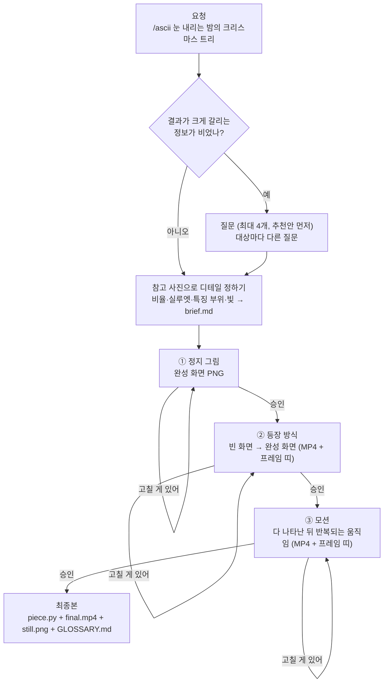

| 단계 | 보여 주는 것 | 고칠 때 바뀌는 범위 | 승인되면 |
|---|---|---|---|
| 0. 질문 | 선택지 2~4개 (추천안 첫 번째) | — | 답을 `brief.md` 에 기록 |
| ① 정지 그림 | PNG 1장 | 구도·형태·글자·밀도·색 | 이 PNG 가 기준 그림 |
| ② 등장 방식 | MP4 + 프레임 띠 | 등장 순서·방향·길이·효과 (①은 그대로) | 등장 고정 |
| ③ 모션 | MP4 + 프레임 띠 | 무엇이·어떻게·얼마나 빨리 움직이는지 (①②는 그대로) | 모션 고정 |
| 최종본 | `piece.py` + `final.mp4` + `still.png` + `GLOSSARY.md` | — | 완료 |

규칙:

- **승인 전에는 다음 단계로 가지 않습니다.** 승인된 단계를 바꿔야 하는 요청이면 어느 단계로 돌아가는지 알리고 확인받습니다.
- **수정마다 버전을 코드로 남깁니다.** `versions/s1_v1/` 에 그 시점의 `piece.py` 와 미리보기가 함께 들어갑니다. "아까 v2 가 나았어" 라고 하면 그 버전의 코드로 되돌립니다.
- **질문은 고정 목록이 아닙니다.** 말이면 걸음걸이·방향, 바다면 시점·파도 세기, 3D 면 회전 방식·표현처럼, 그 작품의 결과를 가장 크게 바꾸는 것을 그때그때 고릅니다.
- **새로 만드는 대상은 상상만으로 그리지 않습니다.** 사용자 사진이 있으면 그것을, 없으면 사진을 검색해 실제 비율·특징 부위·빛을 확인하고 `brief.md` 에 적습니다. 특징 부위는 설정 변수가 됩니다 (예: `ANTLER`, `LEG_POSE`, `SLEIGH_BODY`).
- **진행 상태는 `brief.md` 맨 위에.** 다음 대화에서 `/ascii <작품이름>` 으로 이어 갈 때 여기서 단계를 읽습니다.

---

## 핵심 원칙: 결과물은 코드

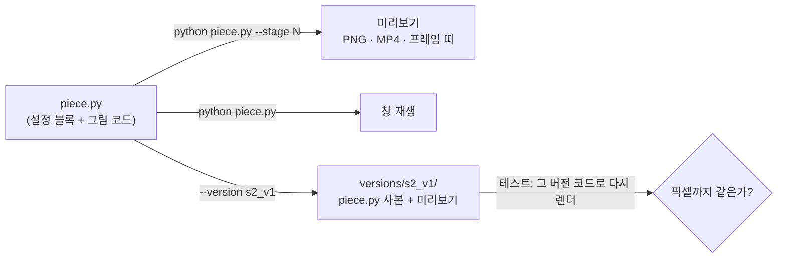

- 미리보기는 언제나 `python piece.py --stage N` 으로만 만듭니다. 손으로 편집하거나 다른 도구로 만들지 않습니다.
- 버전 폴더의 미리보기(정지 그림 PNG, 프레임 띠와 그 프레임 기록 `strip.json`)는 그 버전의 코드로 다시 렌더한 결과와 픽셀까지 같아야 하고, 테스트가 이를 확인합니다.
- 창 재생과 MP4 가 다를 수 있는 것은 실제 시간에 따른 재생 속도뿐입니다. 같은 프레임 번호면 그림은 언제나 같습니다.

---

## 작품 파일의 구조

작품 하나 = 파일 하나 (`pieces/<slug>/piece.py`). 맨 앞은 설정 블록, 그 아래는 코드입니다.

```python
"""크리스마스 트리 — 눈 내린 밤, 불 켜진 트리와 달 앞을 나는 산타 썰매"""
# ===== ① 장면 설정: 여기 값만 바꾸면 아래 코드 전체가 따라 바뀝니다 =====
COLS           = 180                    # 가로 글자 칸 수 (16~400)
ROWS           = 192                    # 세로 글자 칸 수 (8~240)
MOON_R         = 0.34                   # 달 반지름 (화면 좌표)
TIERS          = 5                      # 가지 층 수 (1~9)
# ===== ② 등장 설정 =====
INTRO_SECONDS  = 6.0                    # 등장 길이 (초)
T_TREE         = 0.3                    # 트리가 아래부터 글자로 차오르기 시작 (초)
# ===== ③ 모션 설정 =====
LOOP_SECONDS   = 12                     # 한 루프 길이 (초)
STRIDES        = 30                     # 한 루프 동안 순록 질주 횟수 (정수)
# ===== 최종 출력 =====
FINAL_LOOPS    = 2                      # 최종 영상에서 모션 반복 횟수
# ===== 효과 =====
GLOW           = 0.3                    # 글로우 (0~1)
SEED           = 7                      # 무작위 seed
RANGES         = {"TIERS": (1, 9)}      # 작품 고유 설정의 허용 범위
# ===== 코드 =====
from asciiart.run import run

def setup():                 # 한 번만: 3D 렌더, 위치, 순서 같은 무거운 계산. 난수는 SEED 로만
    ...
def draw(s, phase, grid):    # 그림 하나. 모든 시간 변화는 phase(0..1) 의 정수 주기
    ...
def scene(s, grid):          # ① 완성 화면 = draw(phase=0)
    draw(s, 0.0, grid)
def intro(s, p, grid):       # ② 등장 진행도 p = 0..1, p = 1 이면 scene 그대로
    ...
def motion(s, t, phase, grid):  # ③ 모션 = draw(phase), phase 0 과 1 은 scene 과 같음
    draw(s, phase, grid)

if __name__ == "__main__":
    run(globals())           # 명령줄 처리: 창 재생 · --stage · --final · --check …
```

**단계 연결 규칙** — 이음매가 튀지 않도록 네 화면이 같아야 하고, `--check` 와 테스트가 확인합니다.

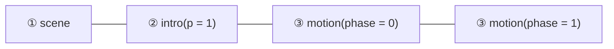

- 설정 변수마다 한 줄 주석 `# 뜻 (단위·범위)` 를 달고, 끝 괄호가 용어집의 범위 칸이 됩니다.
- 엔진(`config.py`)이 범위를 검사해 잘못된 값은 보정하고 경고합니다.
- 파일을 고치지 않고 값을 바꿔 볼 수 있습니다: `python piece.py --set MOON_R=0.3 --set SEED=3`

작품 폴더:

```text
pieces/<slug>/
├── piece.py        작품 코드 (본체)
├── brief.md        요청 원문, 질문과 답, 참고한 모습, 설계, 진행 상태, 수정 기록
├── GLOSSARY.md     설정·함수 용어집 (이름 : 뜻 : 범위)
└── versions/       단계별 버전 (코드 사본 + 미리보기)
    ├── s1_v1/      piece.py, preview.png
    ├── s2_v2/      piece.py, strip.png, strip.json
    ├── s3_v1/      piece.py, strip.png, strip.json
    └── final/      piece.py, still.png
```

---

## 저장소 구조

```text
ascii-art-studio/
├── asciiart/                 엔진 (모든 작품이 공유하는 Python 패키지)
├── pieces/                   작품들 (작품 하나 = 폴더 하나)
│   ├── christmas-tree/       예제 작품 (완료)
│   └── fishing-boat/         시험 작품 (① 단계에서 보류)
├── examples/                 엔진 기능별 데모 (f2 ~ f85)
├── tools/                    new_piece.py · glossary.py · image_to_field.py
├── tests/                    pytest (엔진 + 모든 작품 자동 검사)
├── docs/                     PLAN.md (전체 계획 v4) · images/ (README 그림)
├── .claude/skills/ascii/     /ascii 스킬 (SKILL.md · reference.md · template.py)
├── requirements.txt
└── LICENSE
```

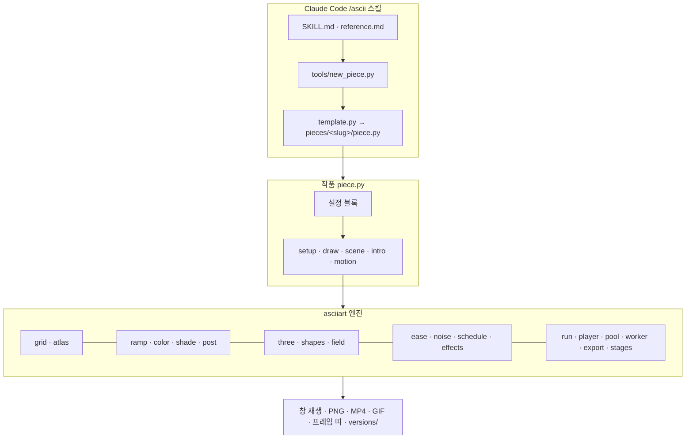

---

## 엔진 (asciiart 패키지)

| 모듈 | 하는 일 |
|---|---|
| `grid.py` | `Grid(cols, rows)`: 글자 코드·칸 색·깊이 버퍼. 화면과 분리돼 창 없이 테스트 가능 |
| `atlas.py` | 글자 모양을 한 번만 그려 두고(글자 아틀라스) grid 전체를 numpy 로 한 번에 이미지로 합성 |
| `ramp.py` | 밝기 → 글자: 램프·감마·디더(해시·바둑판)·반짝임, 밝기 단계별 글자 풀, 윤곽 방향 글자 `\| / - \\` |
| `color.py` | 팔레트 색, 색 단계 줄이기 |
| `shade.py` | 필드 렌더: 칸마다 `(x, y) → RGB` 를 numpy 로 계산, 슈퍼샘플링, 밝기 필드 → 글자 |
| `post.py` | 블룸·톤매핑·비네트 (글자로 바꾸기 전 색 필드에 적용) |
| `ease.py` | `segment`·`smoothstep`·`ease_*`·`overshoot`·키프레임·`loop_sin` (막 연출, 정수 주기 루프) |
| `noise.py` | seed 값 노이즈, fbm, 루프가 이어지는 시간 노이즈 |
| `schedule.py` | seed 로 미리 만드는 무작위 사건 일정표 (탐색·저장해도 같은 결과) |
| `effects.py` | 잔상(선형 감쇠)·글로우. 탐색할 때는 필요한 만큼 앞 프레임부터 다시 그려 같은 결과 |
| `shapes.py` | 2D 도형: 원·타원·막대·다각형·별의 부호 거리, 칸 덮임 비율, 방향 글자 선 |
| `three.py` | 3D: 카메라, SDF 도형(구·상자·원뿔·고리…)과 합치기, 레이마칭, 빛·그림자·AO·안개, 3D 점·선, OBJ |
| `field.py` | 이미지 → 필드(밝기·투명도·윤곽·팔레트), 배치·샘플 |
| `timeline.py` · `stages.py` | 프레임 수·phase 계산, 단계 연결 검사 |
| `config.py` | 맨 앞 설정 수집, `--set` 덮어쓰기, 범위 검사 |
| `player.py` · `pool.py` · `worker.py` | 창 재생(pygame, 없으면 OpenCV), 글자 버퍼 캐시·미리 계산, 무거운 작품은 작업자 프로세스 |
| `export.py` | PNG·MP4(ffmpeg)·GIF·프레임 띠, 끝 프레임 중복 없는 정확한 루프 |
| `run.py` | 작품 실행기: 명령줄 옵션, 단계별 출력, 버전 저장 |

---

## 명령 모음

```bash
python pieces/<slug>/piece.py                      # 창: 등장 한 번 → 모션 반복
python pieces/<slug>/piece.py --stage 1            # ① 완성 화면 PNG
python pieces/<slug>/piece.py --stage 2            # ② 등장 MP4 + 프레임 띠
python pieces/<slug>/piece.py --stage 3            # ③ 모션 MP4 + 프레임 띠
python pieces/<slug>/piece.py --final              # 최종: 등장 1번 + 모션 FINAL_LOOPS 번 + 대표 PNG
python pieces/<slug>/piece.py --check              # 단계 연결 검사
python pieces/<slug>/piece.py --stage 2 --version s2_v1   # 결과물 + 지금 코드를 versions/s2_v1/ 에 저장
python pieces/<slug>/piece.py --set SEED=3         # 설정을 파일 수정 없이 바꿔 실행
python pieces/<slug>/piece.py --mp4 --loops 3      # MP4 / --gif / --strip / --png 45

python tools/new_piece.py <slug> --title "<제목>" --request "<요청 원문>"   # 새 작품 폴더
python tools/glossary.py pieces/<slug>/piece.py                               # 용어집 갱신
python tools/image_to_field.py <이미지> --out pieces/<slug>/field.json --cols 160   # 이미지 → 필드
```

---

## 예제

엔진 기능을 하나씩 만들며 확인한 데모입니다. `python examples/<파일>` 로 실행합니다.

| 파일 | 보여 주는 것 |
|---|---|
| `f2_demo.py` | grid 에 글자와 색을 채워 PNG 로 저장 |
| `f3_demo.py` | 재생 창, 키 조작 (글자 물결) |
| `f4_demo.py` | 밝기 → 글자 방식 비교: 디더, 긴 램프, 글자 풀, 윤곽 방향 글자 |
| `f5_demo.py` | 필드 렌더로 그린 빛나는 구 (블룸·톤매핑) |
| `f6_demo.py` | 흐르는 성운(루프 노이즈), 반짝이는 별, 별똥별(일정표 + 잔상) |
| `f75_demo.py` | 단계 구조: ① 고리 행성 → ② 해독되며 등장 → ③ 폭풍 |
| `f8_demo.py` | 이미지 입력: 그림(코드로 그린 고양이)을 글자로 |
| `f85_demo.py` | 3D: 매끈한 물체, 그림자, 바닥, 둘레를 도는 점 |

---

## 예제 작품: 크리스마스 트리

`pieces/christmas-tree` — 이 저장소의 흐름 그대로 만든 첫 작품입니다. 요청부터 승인까지의 기록은 [`brief.md`](pieces/christmas-tree/brief.md), 설정 설명은 [`GLOSSARY.md`](pieces/christmas-tree/GLOSSARY.md) 에 있습니다.

| 단계 | 내용 |
|---|---|
| ① 정지 그림 | 큰 보름달 속 산타 썰매·순록 실루엣, 5층 3D 트리(달빛·그림자·장식 공·나선 전구·꼭대기 별), 선물 상자, 눈 바닥과 눈송이 |
| ② 등장 (6초) | 트리가 아래부터 한 글자씩 차오름(빛나는 앞줄, 날아와 자리를 찾는 글자) → 장식이 하나씩 켜지며 달이 차오름 → 별 반짝 → 썰매가 날아 들어옴 |
| ③ 모션 (12초 루프) | 썰매가 하늘을 한 바퀴 돌며 왔다 갔다·사라졌다 돌아옴, 순록 질주·고삐 치기, 눈 내림, 전구 빛이 줄을 따라 흐름, 별 반짝임 |

<p align="center">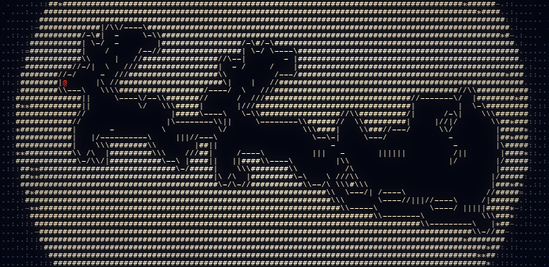</p>

**② 등장 프레임 띠**

<p align="center">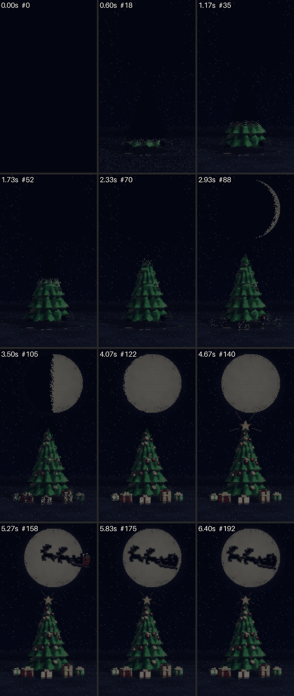</p>

**③ 모션 프레임 띠**

<p align="center">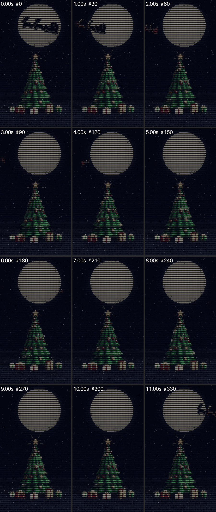</p>

---

## 엔진 실험실: 기능별 테스트

엔진은 기능 하나씩 만들고, 데모와 테스트로 확인한 뒤 다음으로 넘어가며 만들었습니다. 아래는 그때 만든 데모(`examples/*.py`)를 실행해서 뽑은 화면입니다.

<table>
<tr>
<td width="50%" valign="top">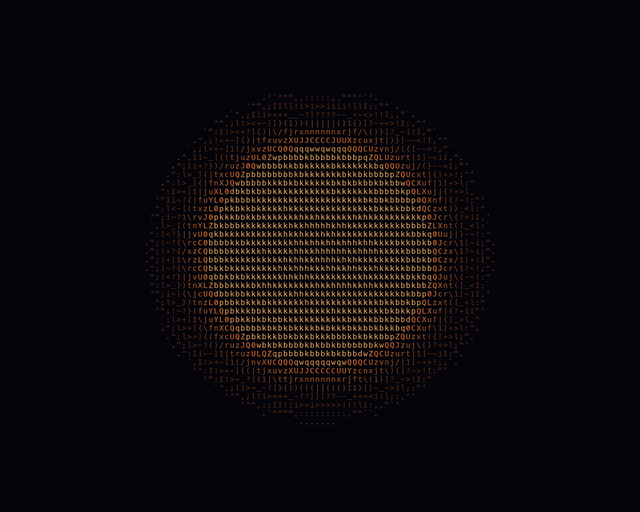<br><b>명암 · 필드 렌더</b><br><sub>칸마다 numpy 로 빛을 계산한 구: 람베르트 조명, 2×2 슈퍼샘플링, 밝기 → 글자 램프(감마·디더).</sub></td>
<td width="50%" valign="top">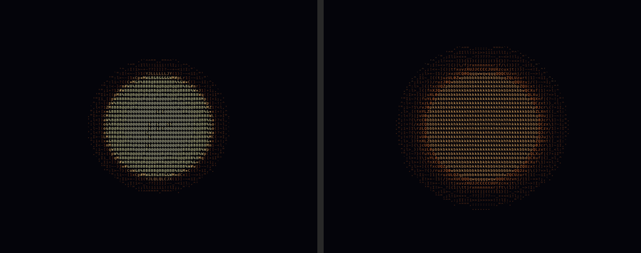<br><b>명암 · 후처리</b><br><sub>같은 필드의 블룸·톤매핑 전후. <code>keep_color</code> 로 밝은 곳을 누르면서 색조는 유지.</sub></td>
</tr>
<tr>
<td width="50%" valign="top">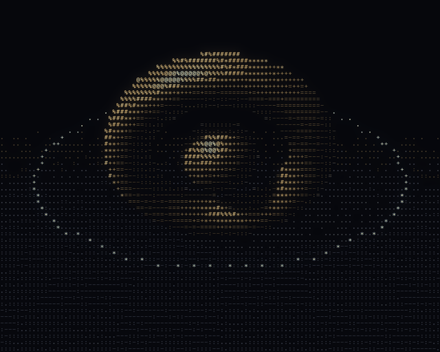<br><b>3D · SDF 레이마칭</b><br><sub>구 + 기울어진 고리(부드럽게 합침), 체크 바닥: 난반사·하이라이트·테두리 빛·부드러운 그림자·거리 안개. 둘레를 도는 점은 깊이 비교로 물체 뒤에서 가려짐.</sub></td>
<td width="50%" valign="top">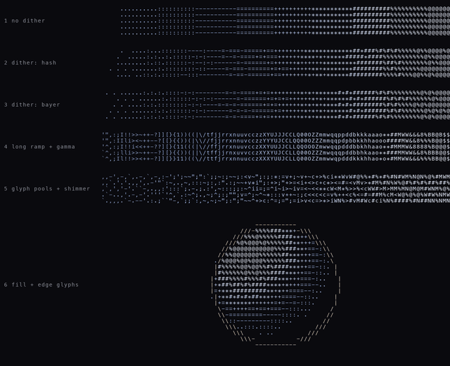<br><b>밝기 → 글자</b><br><sub>한 그라데이션에 여섯 방식: 디더 없음(띠), 칸마다 디더, 바둑판 디더, 긴 램프 + 감마, 글자 풀 + 반짝임, 채움 + 윤곽 방향 글자.</sub></td>
</tr>
<tr>
<td width="50%" valign="top">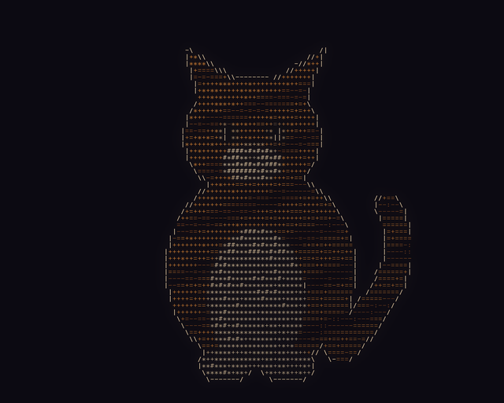<br><b>이미지 입력</b><br><sub>코드로 그린 고양이를 필드(투명도·팔레트·윤곽 방향)로 바꿔 글자로 다시 그림.</sub></td>
<td width="50%" valign="top">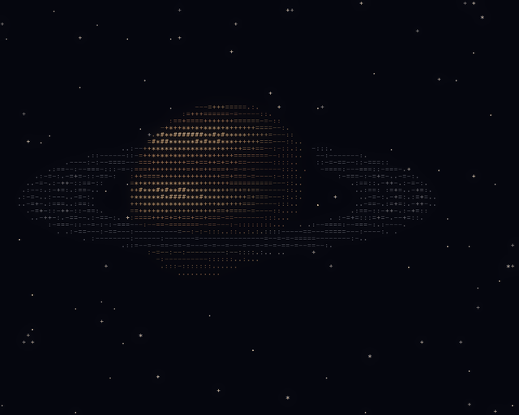<br><b>단계 구조</b><br><sub>고리 행성: ① 정지 → ② 해독되며 등장 → ③ 폭풍 루프, 단계 연결 규칙으로 이어짐.</sub></td>
</tr>
<tr>
<td width="50%" valign="top"><br><b>시간 도구</b><br><sub>루프가 이어지는 노이즈 성운, 별마다 다른 반짝임, seed 일정표로 나오는 별똥별(잔상·글로우).</sub></td>
<td width="50%" valign="top">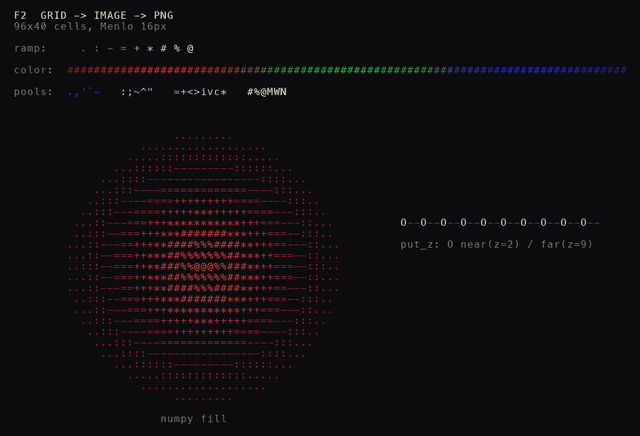<br><b>글자 grid</b><br><sub>가장 아래 층: 글자 코드 + 칸 색을 글자 아틀라스로 그림.</sub></td>
</tr>
</table>

<details>
<summary><b>움직임 프레임 띠</b> — 3D 회전 · 단계 구조 등장/모션 · 별똥별</summary>
<br>
<p align="center">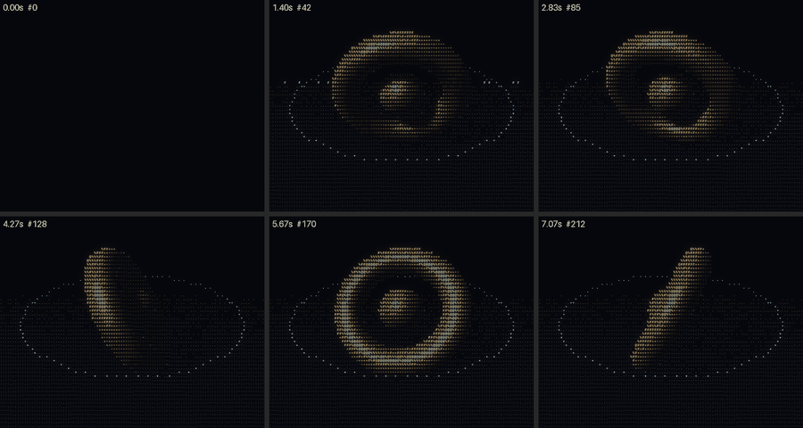</p>
<p align="center">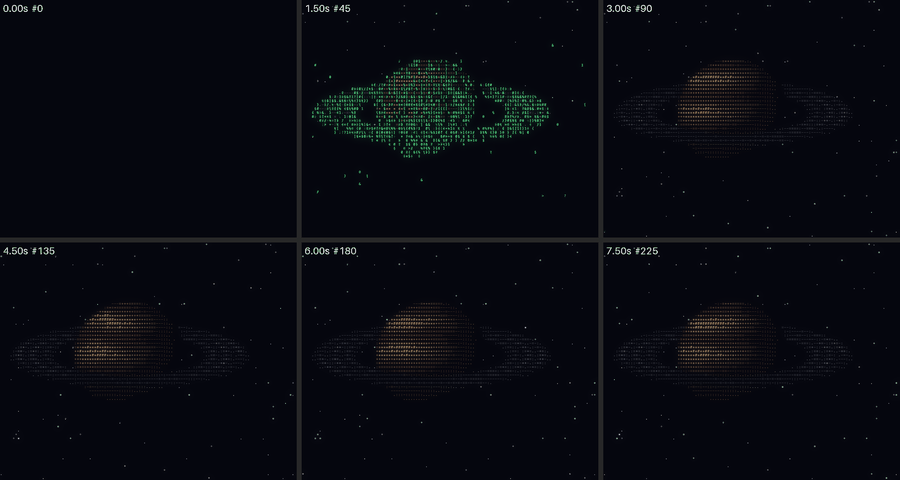</p>
<p align="center">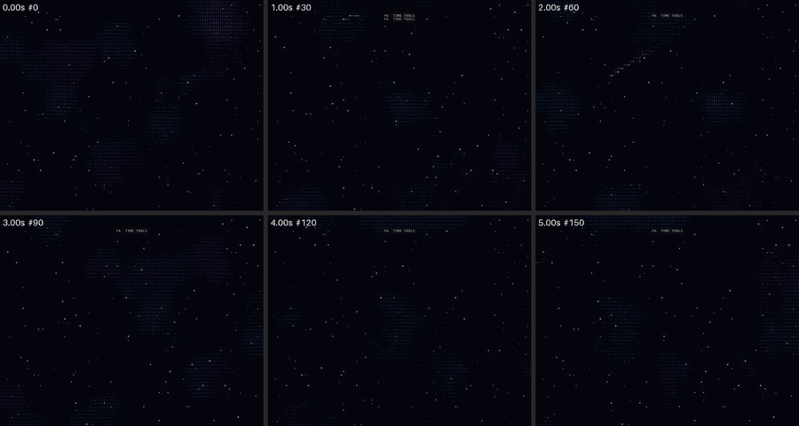</p>
</details>

<details>
<summary><b>첫 시험 작품</b> — <code>pieces/fishing-boat</code> (① 단계에서 보류)</summary>
<br>
<p align="center">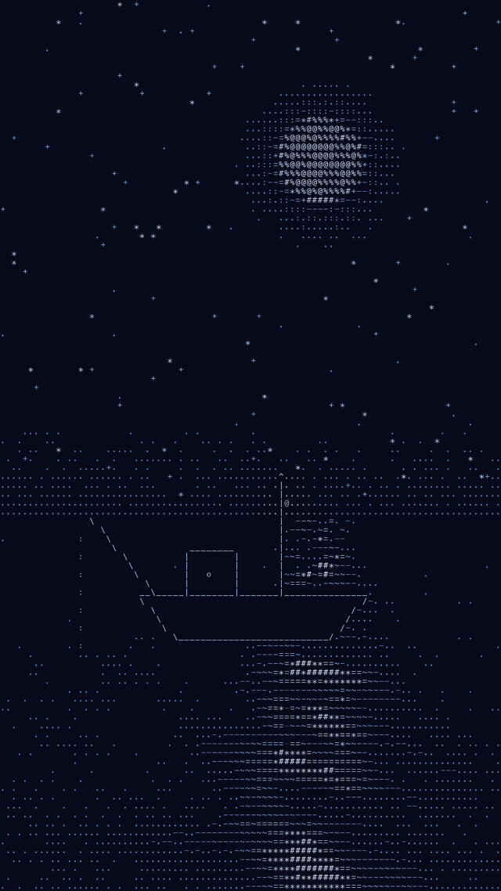</p>
<p align="center"><sub>작업 흐름으로 처음 만든 작품: 차가운 달빛 아래 등불을 단 작은 조각배, 90×100 칸, 9:16.</sub></p>
</details>

---

## 테스트

```bash
python -m pytest
```

- 엔진: 글자 그리기, 재생, 램프·디더, 필드 렌더, 시간 도구·잔상(탐색 재현), 저장(MP4 프레임 수·길이), 단계 구조, 이미지 입력, 3D, 2D 도형
- `pieces/` 아래 **모든 작품 자동 검사**:
  - 설정 블록이 맨 앞에 있는지, 코드 본문에 숫자를 직접 쓰지 않았는지
  - `random`·`time` 을 쓰지 않는지, 같은 코드 → 같은 그림인지
  - 설정을 바꾸면 그림이 바뀌는지
  - 단계 연결 (① = ② 끝 = ③ 처음 = ③ 끝)
  - 버전 미리보기 = 그 버전 코드로 다시 렌더한 결과 (픽셀 단위)
  - 용어집에 이름이 겹치지 않는지, 모든 설정이 용어집에 있는지

---

## 알려진 제한

- **글꼴이 macOS 기준입니다.** 기본 글꼴은 `/System/Library/Fonts/Menlo.ttc` 입니다. 다른 운영체제에서는 경고 후 기본 글꼴로 그려 글자 모양과 간격이 달라질 수 있습니다. 작품 맨 앞의 `FONT` 에 그 컴퓨터의 고정폭 글꼴 파일 경로를 넣으면 됩니다.
- **스킬 안내문의 실행 명령이 개발 환경 기준입니다.** `SKILL.md` 의 `conda activate min` 같은 명령은 각자 환경에 맞게 바꿔 쓰면 됩니다.
- **무거운 작품의 첫 재생.** 크리스마스 트리는 작업자 프로세스마다 3D 트리를 약 20초씩 계산해서, 창 재생 첫 한 바퀴는 프레임을 건너뜁니다. MP4 저장에는 영향이 없습니다.
- **영상 파일은 저장소에 없습니다.** 저장소를 가볍게 하려고 MP4·GIF 를 뺐습니다 (README 데모 GIF 만 있음). 같은 명령으로 다시 만들면 같은 영상이 나옵니다.

---

## 라이선스와 출처 표기

[MIT License + 출처 표기 조건](LICENSE) © 2026 applelog

자유롭게 쓰고, 고치고, 배포할 수 있습니다. 대신 다음 두 가지를 지켜 주세요.

1. **출처 표기 필수.** 코드를 쓰거나 고치거나 배포할 때, 그리고 이것으로 만든 작품(그림·영상·제품)을 공개할 때 아래 문구를 보이는 곳(README, 크레딧, 영상 설명, 게시글 등)에 남겨 주세요.

   ```text
   ascii-art-studio by applelog — https://github.com/applelog/ascii-art-studio
   ```

2. **AI 를 쓸 때도 출처 표기 필수.** 이 저장소의 코드·문서·결과물을 AI 학습·미세 조정 데이터, 검색·색인, 코드 생성, AI 에이전트·스킬 등에 쓸 때도, 그 결과물(모델·데이터셋 문서, 생성된 코드나 작품)에 같은 문구를 남겨 주세요.

---

## English summary

**ascii-art-studio** is a Claude Code skill (`/ascii`) plus a Python engine (`asciiart`) that turns a plain-language request into an **animated ASCII-art program**. Each request produces a new `piece.py`. Everything on screen is computed by code. No generative image/video models, API keys or servers are used.

- **Workflow (v4):** clarifying questions → ① still → ② intro → ③ motion → final. Each stage is revised until the user approves it.
- **Code is the deliverable.** Previews (PNG/MP4/frame strips) are rendered by running the piece itself. Versions are saved as code snapshots. Tests check that every saved preview is pixel-identical to a re-render of its version.
- **Settings block first.** Every tunable value sits at the top of the file, C-`#define` style. No magic numbers appear in the code body (checked by tests).
- **Engine:**
  - glyph atlas renderer
  - brightness ramps, dithering and edge-direction glyphs
  - field rendering with bloom and tonemapping
  - 2D signed-distance shapes
  - 3D SDF ray marching with shadows and fog
  - image fields
  - loopable noise
  - trail and glow
  - pygame player with worker-process prefetch
  - MP4/GIF/strip export
- **Run a piece:** `pip install -r requirements.txt` then `python pieces/christmas-tree/piece.py`. Developed on macOS with Python 3.8. The default font is Menlo; set `FONT` to a monospace font file on other systems.
- **License:** MIT with attribution terms. Credit `ascii-art-studio by applelog — https://github.com/applelog/ascii-art-studio` whenever you use, modify or distribute it, publish works made with it, **or use it with AI systems** (training data, retrieval, code generation, agents/skills). See [LICENSE](LICENSE).
