<div align="center">

# ascii-art-studio

**Describe it. Get animated ASCII art — as runnable Python code.**

A Claude Code skill (`/ascii`) and a NumPy rendering engine that turn plain-language requests
into self-contained, deterministic ASCII-art animation programs.

[](#requirements)
[](LICENSE)
[](#testing)
[](#known-limitations)
[](#create-a-piece-with-ascii)
[](#design-principles)

[Quick Start](#quick-start) · [How It Works](#how-it-works) · [Piece Anatomy](#piece-anatomy) · [Engine API](#engine-api) · [CLI](#cli-reference) · [Examples](#examples) · [Engine Lab](#engine-lab) · [Testing](#testing) · [License](#license--attribution)

**English** · [한국어](README.ko.md)

<br>

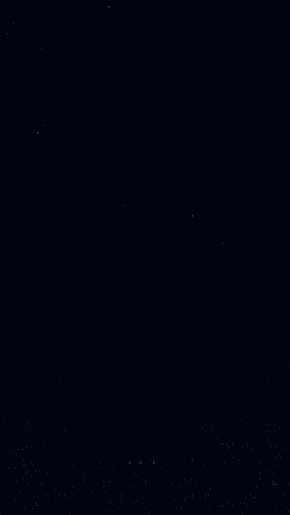
&nbsp;&nbsp;
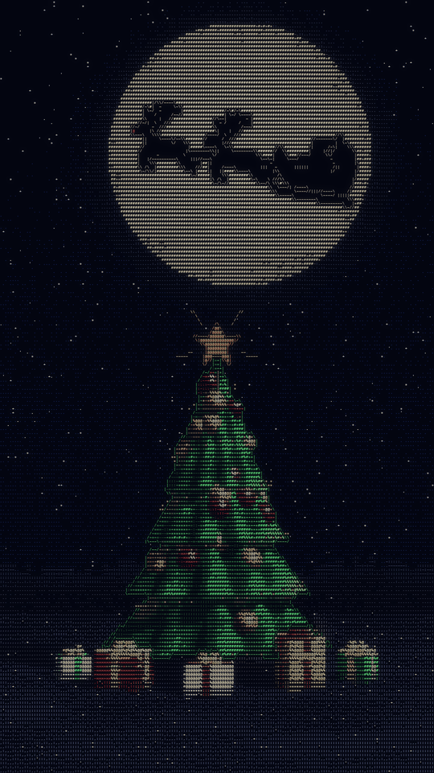

<sub><code>pieces/christmas-tree</code> · 1080×1920 · 180×192 glyph cells · every pixel produced by <code>python piece.py</code></sub>

</div>

---

## Why

Most "ASCII art" tools convert a picture. This one **writes a program**.

```text
/ascii a snowy night with a decorated Christmas tree
```

The skill asks a few targeted questions, looks at real reference photos for proportions, and writes
`pieces/<slug>/piece.py`. The script draws a still frame, an intro and a looping motion, using only
letters, digits and symbols. No image or video generation models, API keys or servers are involved.
The images and GIFs in this README are output of the code itself.

## Highlights

| | |
|---|---|
| 🧩 **A new program per request** | No preset effects. Shape, light and motion code are written for each subject. |
| ✅ **Staged approval workflow** | Questions → ① still → ② intro → ③ motion → final. Each stage is iterated until approved. |
| 🎛️ **`#define`-style settings block** | Every tunable value lives at the top of the file. No magic numbers in the code body (enforced by tests). |
| 🔁 **Deterministic & seekable** | Same frame index → same pixels. Randomness only through `SEED`. Effects with history rebuild exactly on seek. |
| 🧪 **Previews are verified** | Saved previews are re-rendered from their versioned code and compared pixel-for-pixel in CI-style tests. |
| 🌐 **Many drawing methods** | Brightness fields, edge-direction glyphs, 2D SDF shapes, 3D SDF ray marching (shadows, AO, fog), 3D points with depth, image fields. |
| 🎬 **Playback & export** | pygame player at 30 fps with worker-process prefetch. PNG / MP4 / GIF / frame strips. |
| 📖 **Self-documenting** | Each piece ships a `GLOSSARY.md` (name : meaning : range) generated from its settings. |

## Quick Start

### Requirements

- Python 3.8+ (developed on 3.8)
- `numpy`, `Pillow`, `pygame-ce` (player), `opencv-python` (fallback player, effects), `pytest`
- [ffmpeg](https://ffmpeg.org/) on `PATH`. This is only needed for MP4 export.
- macOS for the default font (Menlo). See [Known limitations](#known-limitations).

### Run a piece

```bash
git clone https://github.com/applelog/ascii-art-studio.git
cd ascii-art-studio
pip install -r requirements.txt

python pieces/christmas-tree/piece.py          # window: intro once → motion loop
```

| Key | Action |
|---|---|
| `Space` | pause / resume |
| `R` | restart from the intro |
| `S` | save current frame |
| `←` `→` | step frames |
| `Esc` | quit |

### Render instead of play

```bash
python pieces/christmas-tree/piece.py --stage 1     # still PNG      → pieces/christmas-tree/out/
python pieces/christmas-tree/piece.py --final       # intro + 2 loops MP4 + still PNG
```

## Create a piece with `/ascii`

Open the repository in [Claude Code](https://claude.com/claude-code). The skill lives in
`.claude/skills/ascii/`, so `/ascii` is available as soon as you open the folder.

```text
/ascii stormy ocean waves at dusk
/ascii an eye that opens into deep space
/ascii a rotating 3D donut with soft shadows
/ascii (attach an image) make this cat breathe
/ascii christmas-tree more snow        # continue an existing piece
```

| File | Purpose |
|---|---|
| [`SKILL.md`](.claude/skills/ascii/SKILL.md) | The procedure: question rules, reference-photo rule, stages, verification, reporting |
| [`reference.md`](.claude/skills/ascii/reference.md) | Engine API cheat sheet, technique recipes, quality checklist, common pitfalls |
| [`template.py`](.claude/skills/ascii/template.py) | Staged piece skeleton copied by `tools/new_piece.py` |

## How It Works

### Workflow (v4)

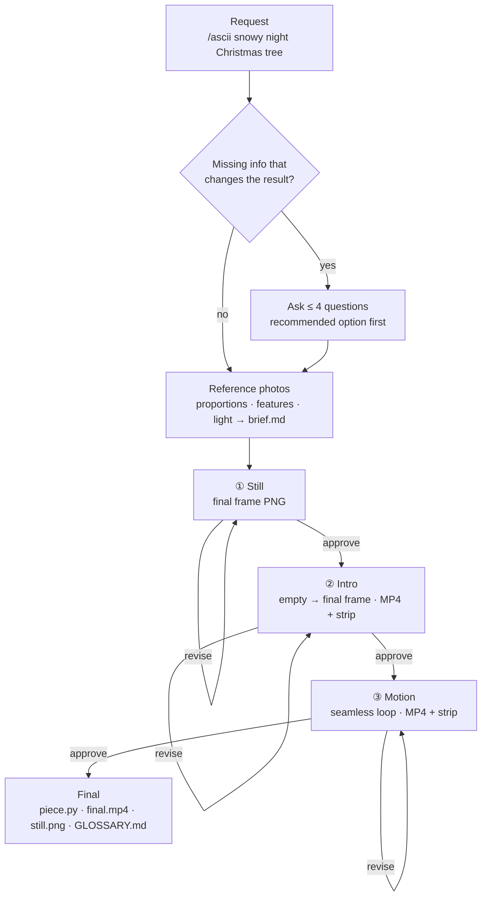

| Stage | Shown | What a revision may change | On approval |
|---|---|---|---|
| 0 · Questions | 2–4 options, recommendation first | — | answers recorded in `brief.md` |
| ① Still | one PNG | composition, shapes, glyphs, density, color | becomes the reference frame |
| ② Intro | MP4 + frame strip | order, direction, timing, effects (① locked) | intro locked |
| ③ Motion | MP4 + frame strip | what moves, how, how fast, loop length (①② locked) | motion locked |
| Final | `piece.py` + `final.mp4` + `still.png` + `GLOSSARY.md` | — | done |

- **No stage is skipped without explicit approval.** A change that touches an approved stage goes back to that stage, and the stages after it are approved again.
- **Every revision is versioned as code.** `versions/s1_v2/` holds the `piece.py` snapshot and its preview. Reverting means restoring code.
- **Questions are chosen per subject, not from a fixed list.** For a horse: gait and direction. For the sea: viewpoint and wave height. For 3D: object vs. camera rotation.
- **New subjects are grounded in reference photos.** Proportions and 3–6 identifying features are written to `brief.md` and exposed as settings, e.g. `ANTLER`, `LEG_POSE`, `SLEIGH_BODY`.
- **Progress lives at the top of `brief.md`**, so `/ascii <slug>` resumes at the right stage in a new session.

### Design principles

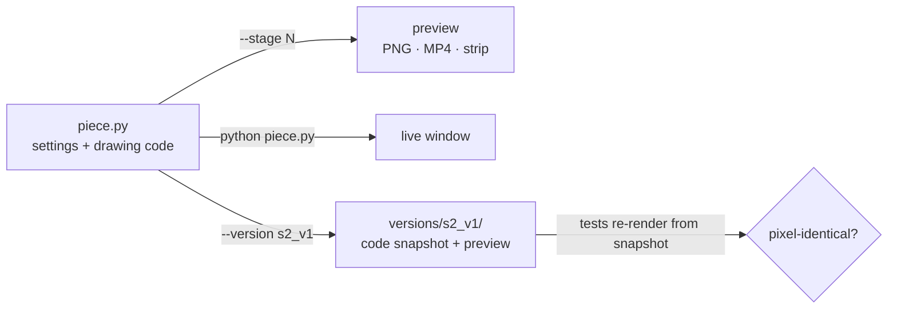

1. **Code is the deliverable; media are previews.** Previews are produced only by running the piece.
2. **Determinism.** No `random` or `time` in render paths. Random schedules are precomputed from `SEED` in `setup()`.
3. **Seamless loops.** All motion uses integer cycles of `phase ∈ [0, 1)`. The four boundary frames must be identical.
4. **Heavy work once.** 3D renders, masks and orders are computed in `setup()`. The player prefetches frames in worker processes.

## Piece Anatomy

One piece = one file. Settings first, code below.

```python
"""Christmas tree — a snowy night, a lit tree and Santa's sleigh across the moon"""
# ===== ① scene settings: change values here, the code below follows =====
COLS           = 180                    # glyph columns (16~400)
ROWS           = 192                    # glyph rows (8~240)
MOON_R         = 0.34                   # moon radius (screen units)
TIERS          = 5                      # branch tiers (1~9)
# ===== ② intro =====
INTRO_SECONDS  = 6.0                    # intro length (s)
T_TREE         = 0.3                    # tree starts filling in (s)
# ===== ③ motion =====
LOOP_SECONDS   = 12                     # loop length (s)
STRIDES        = 30                     # reindeer strides per loop (integer)
# ===== final output =====
FINAL_LOOPS    = 2                      # motion loops in final.mp4
# ===== effects =====
GLOW           = 0.3                    # glow (0~1)
SEED           = 7                      # random seed
RANGES         = {"TIERS": (1, 9)}      # allowed ranges for piece-specific settings
# ===== code =====
from asciiart.run import run

def setup():                    # once: 3D renders, positions, orders. Randomness from SEED only
    ...
def draw(s, phase, grid):       # one frame. Every time change is an integer cycle of phase
    ...
def scene(s, grid):             # ① still   = draw(phase = 0)
    draw(s, 0.0, grid)
def intro(s, p, grid):          # ② intro   p ∈ [0, 1], p = 1 → scene
    ...
def motion(s, t, phase, grid):  # ③ motion  = draw(phase), phase 0 and 1 → scene
    draw(s, phase, grid)

if __name__ == "__main__":
    run(globals())              # CLI: play · --stage · --final · --check · --version · --set
```

**Stage-link invariant.** This is checked by `--check` and by the test suite:

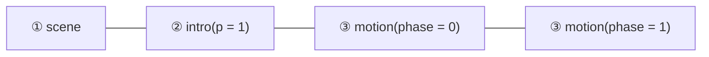

- Each setting carries a one-line comment `# meaning (unit · range)`. The trailing range feeds the glossary.
- `config.py` validates ranges, clamps bad values and warns.
- Try values without editing the file: `python piece.py --set MOON_R=0.3 --set SEED=3`

```text
pieces/<slug>/
├── piece.py        the piece
├── brief.md        request, Q&A, reference notes, design, progress, revision log
├── GLOSSARY.md     settings & functions (name : meaning : range)
└── versions/       code snapshots + previews
    ├── s1_v1/      piece.py, preview.png
    ├── s2_v2/      piece.py, strip.png, strip.json
    ├── s3_v1/      piece.py, strip.png, strip.json
    └── final/      piece.py, still.png
```

## Architecture

```text
ascii-art-studio/
├── asciiart/                 rendering engine (shared by all pieces)
├── pieces/                   one folder per piece
│   ├── christmas-tree/       example piece (complete)
│   └── fishing-boat/         test piece (paused at stage ①)
├── examples/                 per-feature engine demos (f2 … f85)
├── tools/                    new_piece.py · glossary.py · image_to_field.py
├── tests/                    pytest: engine + automatic checks for every piece
├── docs/                     PLAN.md (full v4 plan) · images/
├── .claude/skills/ascii/     the /ascii skill
├── requirements.txt
└── LICENSE
```

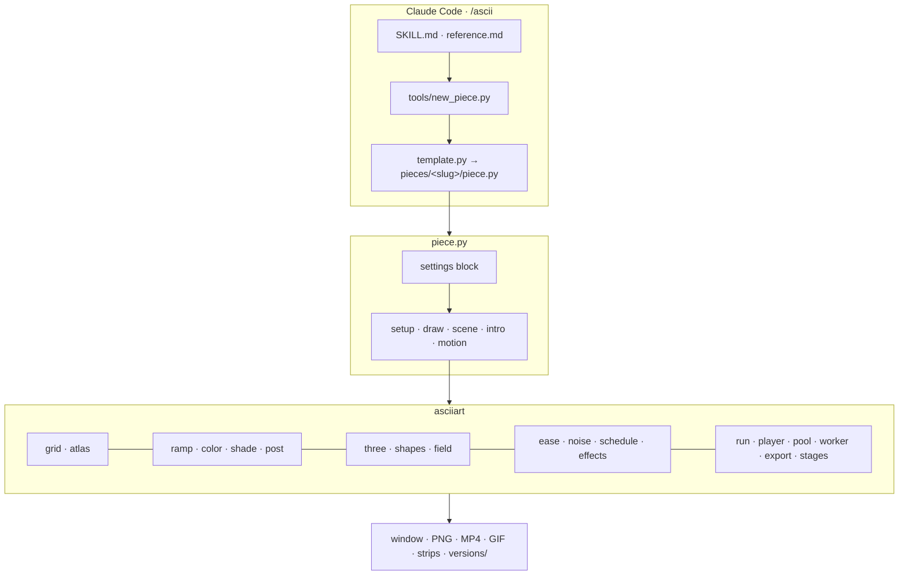

## Engine API

| Module | Responsibility |
|---|---|
| `grid` | `Grid(cols, rows)`: glyph codes, per-cell RGB, depth buffer. Display-independent and testable headless. |
| `atlas` | Glyph atlas: rasterize each glyph once, then composite the whole grid with NumPy |
| `ramp` | Brightness → glyphs: ramps, gamma, hash/Bayer dither, shimmer, glyph pools, edge glyphs `\| / - \\` |
| `color` | Palette mapping, color quantization |
| `shade` | Field rendering `(x, y) → RGB` with supersampling, field → glyphs |
| `post` | Bloom, tonemapping, vignette (applied to the color field before glyph mapping) |
| `ease` | `segment`, `smoothstep`, `ease_*`, `overshoot`, keyframes, `loop_sin` |
| `noise` | Seeded value noise, fBm, loop-safe time noise |
| `schedule` | Seeded event schedules (deterministic under seek/export) |
| `effects` | Trail (linear decay) and glow, exact rebuild on seek via `warmup_frames` |
| `shapes` | 2D signed distances (circle, ellipse, tapered capsule, polygon, star), cell coverage, direction-glyph lines |
| `three` | Camera, SDF primitives (incl. capped cone) and CSG, ray marching, lighting, soft shadows, AO, fog, 3D points/lines, OBJ |
| `field` | Image → field (luminance, alpha, edges, palette), placement and sampling |
| `timeline` · `stages` | Frame/phase math, stage-link report |
| `config` | Settings discovery, `--set` overrides, range validation |
| `player` · `pool` · `worker` | pygame/OpenCV player, grid cache and prefetch, subprocess workers for heavy pieces |
| `export` | PNG, MP4 (ffmpeg), GIF, frame strips, exact loops without duplicate end frames |
| `run` | Piece runner: CLI, stage outputs, versioning |

## CLI Reference

```bash
python pieces/<slug>/piece.py                        # play: intro once → motion loop
python pieces/<slug>/piece.py --stage 1|2|3          # ① still PNG · ② intro MP4+strip · ③ motion MP4+strip
python pieces/<slug>/piece.py --final                # intro + FINAL_LOOPS × motion MP4 + still PNG
python pieces/<slug>/piece.py --check                # stage-link check
python pieces/<slug>/piece.py --stage 2 --version s2_v1   # save outputs + code snapshot to versions/s2_v1/
python pieces/<slug>/piece.py --set KEY=VALUE        # override settings without editing the file
python pieces/<slug>/piece.py --mp4 --loops 3        # also: --gif · --strip [--strip-count N] · --png FRAME
python pieces/<slug>/piece.py --player opencv        # player backend: auto | pygame | opencv
```

```bash
python tools/new_piece.py <slug> --title "<title>" --request "<request>"   # scaffold a piece
python tools/glossary.py pieces/<slug>/piece.py                             # regenerate GLOSSARY.md
python tools/image_to_field.py <image> --out pieces/<slug>/field.json --cols 160   # image → field
```

## Examples

| Demo | Shows |
|---|---|
| `examples/f2_demo.py` | glyph grid → PNG |
| `examples/f3_demo.py` | live player and controls |
| `examples/f4_demo.py` | dithering, long ramps, glyph pools, edge glyphs |
| `examples/f5_demo.py` | field rendering, bloom, tonemapping |
| `examples/f6_demo.py` | looping noise nebula, twinkling stars, meteors (schedule + trail) |
| `examples/f75_demo.py` | staged piece: ringed planet → decode intro → storm |
| `examples/f8_demo.py` | image input (a code-drawn cat) |
| `examples/f85_demo.py` | 3D SDF: shadows, floor, orbiting points with occlusion |

### Showcase: `pieces/christmas-tree`

| Stage | Content |
|---|---|
| ① Still | sleigh and reindeer silhouetted on a full moon; a 5-tier 3D tree with moonlight, shadows, baubles, spiral lights and a star; gifts; snow |
| ② Intro · 6 s | the tree fills in glyph by glyph with a glowing front, and stray glyphs fly into place. Decorations light up while the moon waxes. The star flashes and the sleigh flies in. |
| ③ Motion · 12 s loop | the sleigh circles the sky, shrinks behind the moon and returns; galloping reindeer, rein snaps; snowfall; chasing lights; twinkling stars |

<p align="center">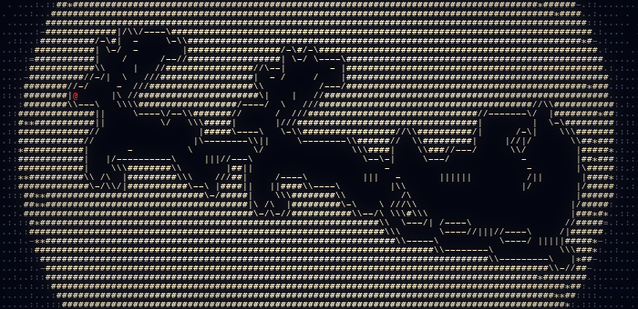</p>

<details>
<summary><b>Frame strips</b> (intro · motion)</summary>
<br>
<p align="center">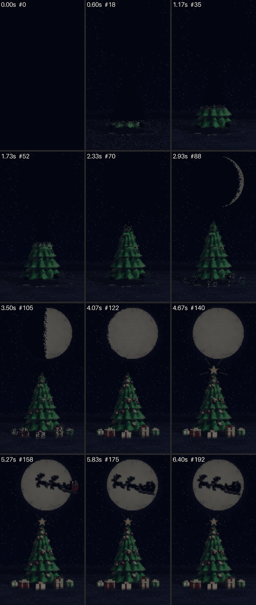</p>
<p align="center">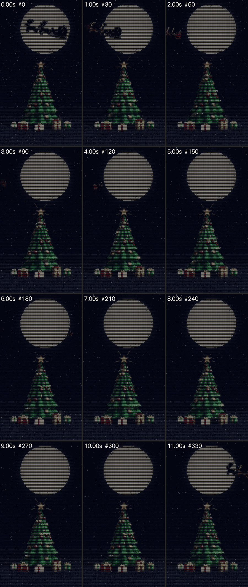</p>
</details>

The full request-to-approval log is in [`brief.md`](pieces/christmas-tree/brief.md). Every setting is documented in [`GLOSSARY.md`](pieces/christmas-tree/GLOSSARY.md).

## Engine Lab

The engine was built one feature at a time. Each feature was proven by a demo and a test before the next one began. These are the outputs of those demos, rendered by running `examples/*.py`.

<table>
<tr>
<td width="50%" valign="top">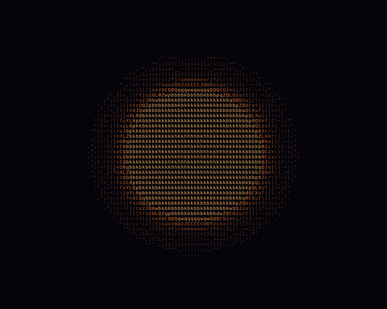<br><b>Shading · field rendering</b><br><sub>A lit sphere computed per cell in NumPy: Lambert light, 2×2 supersampling, luminance → glyph ramp with gamma and dither.</sub></td>
<td width="50%" valign="top">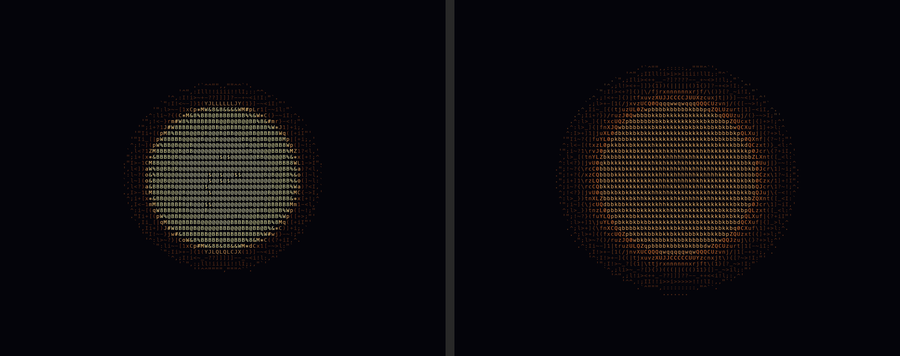<br><b>Shading · post-processing</b><br><sub>Same field before/after bloom and tonemapping. <code>keep_color</code> keeps hue while compressing highlights.</sub></td>
</tr>
<tr>
<td width="50%" valign="top">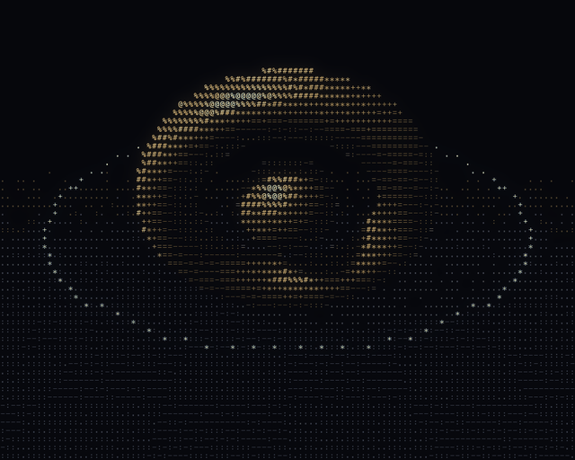<br><b>3D · SDF ray marching</b><br><sub>Sphere + tilted torus (smooth union) over a checker floor: diffuse, specular, rim light, soft shadows, distance fog. Orbiting points are hidden behind the object by depth test.</sub></td>
<td width="50%" valign="top">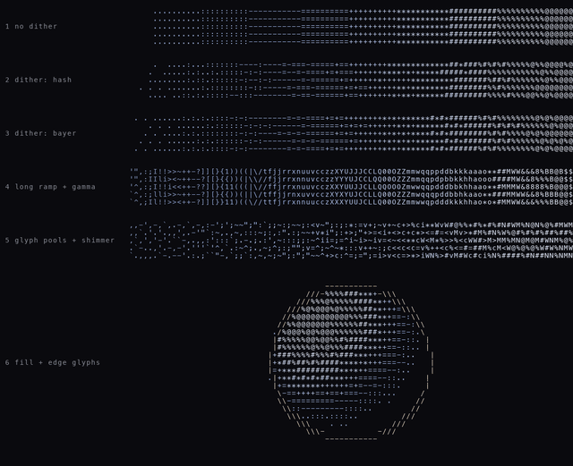<br><b>Brightness → glyphs</b><br><sub>Six methods on one gradient: no dither (banding), hash dither, Bayer dither, long ramp + gamma, glyph pools + shimmer, fill + edge-direction glyphs.</sub></td>
</tr>
<tr>
<td width="50%" valign="top">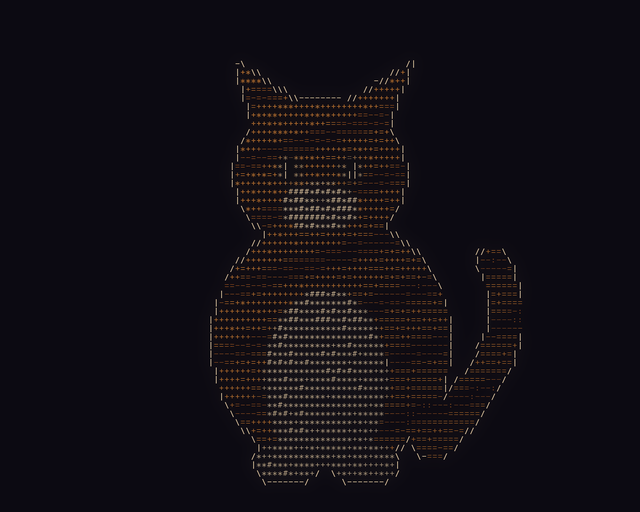<br><b>Image input</b><br><sub>A code-drawn cat converted to a field (alpha matte, palette, edge directions) and redrawn as glyphs.</sub></td>
<td width="50%" valign="top">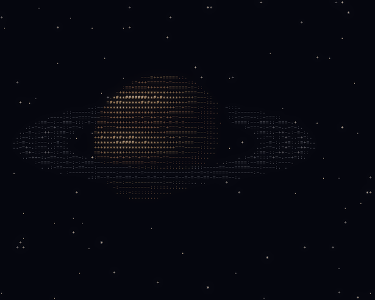<br><b>Staged piece</b><br><sub>Ringed planet: ① still → ② decode-style intro → ③ storm loop, joined by the stage-link invariant.</sub></td>
</tr>
<tr>
<td width="50%" valign="top">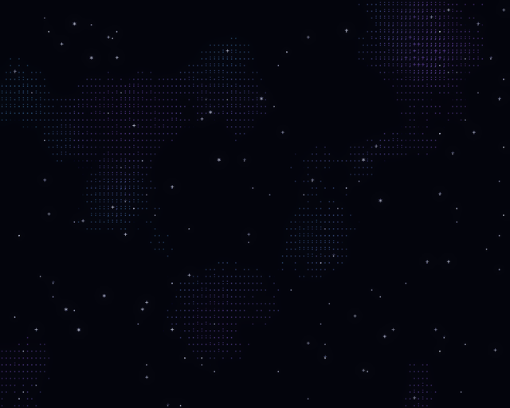<br><b>Time tools</b><br><sub>Loop-safe noise nebula, per-star twinkle, seeded meteor schedule with trail and glow.</sub></td>
<td width="50%" valign="top">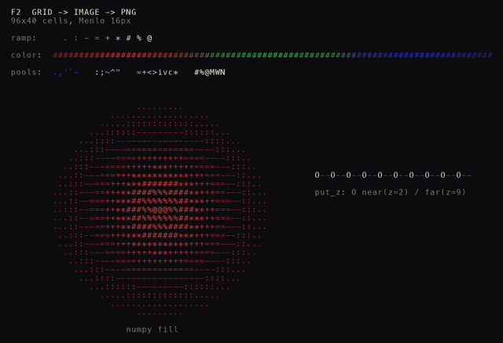<br><b>Glyph grid</b><br><sub>The base layer: glyph codes + per-cell RGB rasterized through the glyph atlas.</sub></td>
</tr>
</table>

<details>
<summary><b>Motion strips</b> — 3D rotation · staged intro/motion · meteors</summary>
<br>
<p align="center">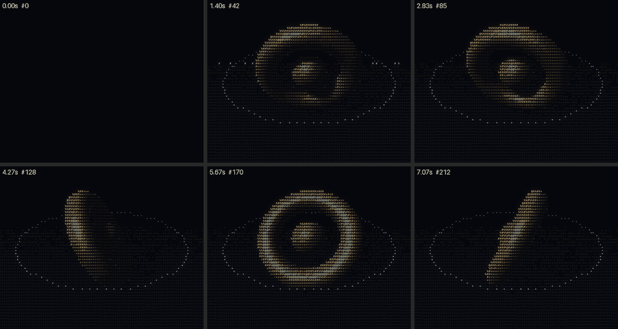</p>
<p align="center">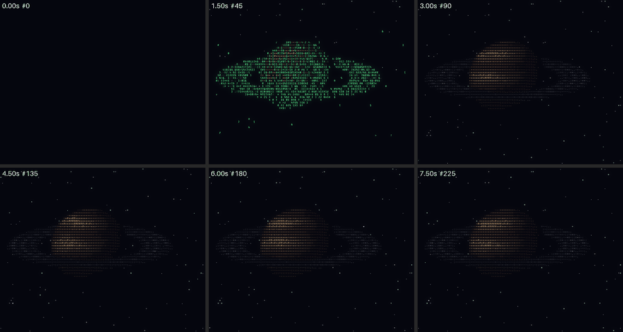</p>
<p align="center">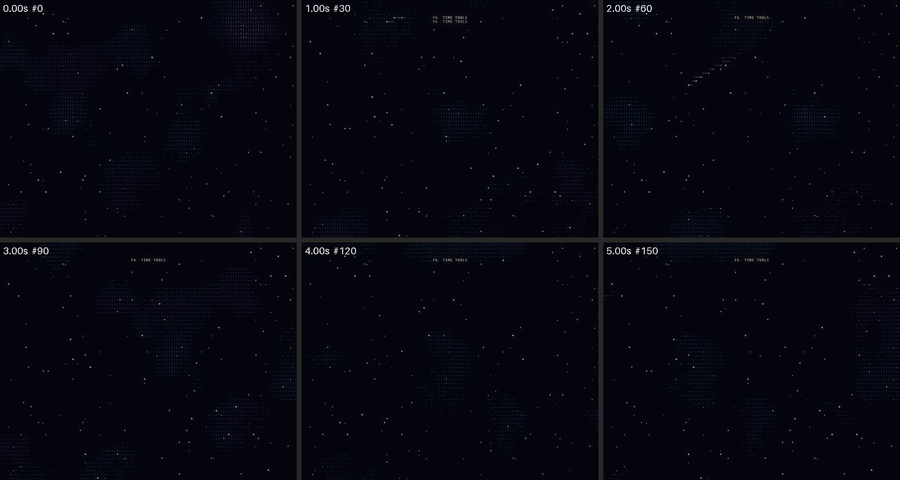</p>
</details>

<details>
<summary><b>Early test piece</b> — <code>pieces/fishing-boat</code> (paused at stage ①)</summary>
<br>
<p align="center">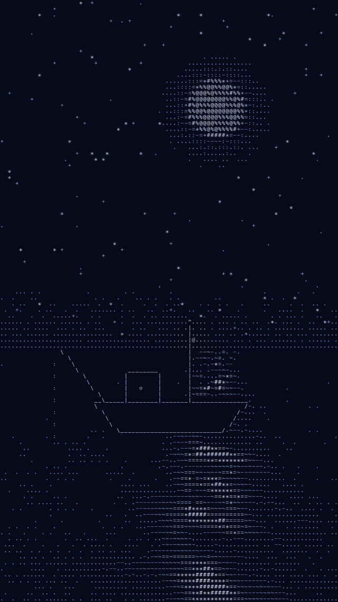</p>
<p align="center"><sub>The first piece made with the workflow: a small boat with a lantern under cold moonlight, 90×100 cells, 9:16.</sub></p>
</details>

## Testing

```bash
python -m pytest          # 191 tests
```

**Engine:** rasterization, player, ramps and dithering, field rendering, time tools and trail rebuild, export (frame count, duration), staged pieces, image fields, 3D, 2D shapes.

**Every piece under `pieces/` is checked automatically.** A new piece is covered without writing a test.

| Check | Rule |
|---|---|
| settings block | settings come first, with `COLS` and `ROWS`, and no imports above them |
| no magic numbers | the code body has only `0`, `1`, `2`, `0.5` |
| determinism | no `random` or `time`; same code → identical grid and pixels |
| settings matter | changing `SEED` changes the picture |
| stage link | ① = ② end = ③ start = ③ end |
| preview = code | each `versions/*` preview equals a re-render of that snapshot, pixel for pixel |
| glossary | names are unique and every setting is documented |

## Known Limitations

- **macOS font path.** The default `FONT` is `/System/Library/Fonts/Menlo.ttc`. Elsewhere the engine warns and falls back to Pillow's default font, so glyph shapes and spacing will differ. Set `FONT` to any monospace `.ttf`/`.ttc` path.
- **Skill commands reflect the dev setup.** `SKILL.md` invokes Python through a conda environment named `min`. Adapt it to your environment.
- **First playback of heavy pieces.** Each worker process runs `setup()`. That takes about 20 s for the Christmas tree's 3D render, so the first loop may drop frames. Exported MP4s are not affected.
- **No videos in the repo.** MP4s and GIFs are excluded to keep the repository light; only the README demo GIF is kept. Re-running the same command reproduces them exactly.

## License & Attribution

[MIT with attribution terms](LICENSE) © 2026 applelog

You may use, modify and distribute this project freely, under two conditions.

1. **Attribution is required.** Credit the project wherever people see or use your code or work: a README, credits, video description or post caption.
2. **Attribution is required for AI use.** The same applies when the code, docs or outputs are used with or by AI systems: training or fine-tuning data, retrieval or indexing, code generation, agents or skills. Credit it in the model or dataset documentation or in the generated output.

```text
ascii-art-studio by applelog — https://github.com/applelog/ascii-art-studio
```
